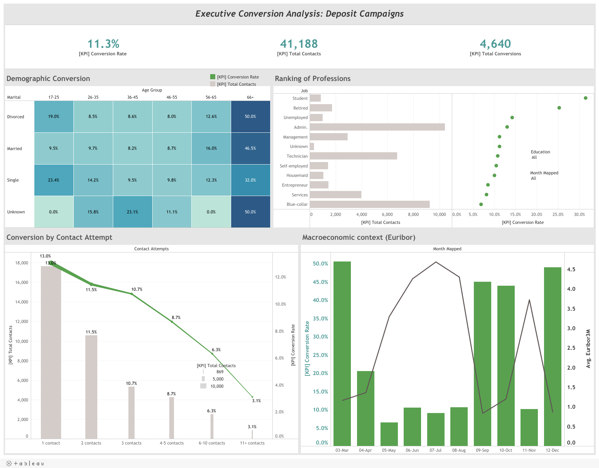

*Read this in other languages: [Español](README_es.md)*

# Financial Telemarketing Campaign Analysis & Conversion Optimization

## Interactive Dashboard

Explore the interactive analysis in Tableau Public:
[View Dashboard in Tableau Public](https://public.tableau.com/app/profile/armando.guarnera/viz/BankMarketingDashboard_17825746467410/ExecutiveConversionAnalysisDepositCampaigns)

## Dashboard Preview



## Business Context and Executive Summary

This project analyzes direct telemarketing campaigns run by a Portuguese retail bank between May 2008 and November 2010. The business goal is to understand which sociodemographic, operational and macroeconomic factors are associated with a client subscribing to a term deposit.

Acquiring customers in retail banking is increasingly competitive and expensive. The analysis helps marketing directors and call-center managers decide **whom to call and how many times**, reducing the cost of cold calls and improving campaign return.

---

## Data Pipeline Architecture (`etl_pipeline.py`)

A reproducible Python ETL pipeline takes the data from ingestion to a clean dataset optimized for Tableau.

### Data Engineering Stages

#### Automated Ingestion

- Downloads the compressed dataset from the UCI Machine Learning Repository.
- Extracts it and manages the local file structure with `os`.

#### Feature Engineering and Transformation

##### Binary Target (`conversion_flag`)

Converts the target `y` ("yes"/"no") into a 1/0 flag, so conversion rates can be computed directly in the BI layer.

##### Age Bands (`age_group`)

Groups age into business segments: `17-25`, `26-35`, `36-45`, `46-55`, `56-65` and `66+`.

##### Categorical Standardization

Labels missing values as `Unknown` and applies consistent capitalization to categorical variables such as `job`, `marital` and `education`.

##### Chronological Month Order (`month_mapped`)

Converts month codes into sortable labels (`03-Mar` ... `12-Dec`) so Tableau keeps the calendar order.

### A Deliberate Exclusion: Call Duration

Call duration is strongly related to conversion, but it is only known **after** the call ends: a long call is a consequence of an interested client, not a lever to choose whom to call. The dashboard therefore analyzes **contact attempts**, which the bank controls before dialing.

---

## Tableau Dashboard Design

The dashboard avoids default templates and applies visual analytics principles.

### Reducing Cognitive Load

- Unnecessary gridlines and borders removed.
- High-intensity colors reserved for actionable metrics; context in neutral grays.

### Synchronized Dual Axes

For charts that combine metrics on different scales (contact volume vs. conversion rate), axis labels match the color of their marks and redundant legends are removed.

### Executive Summary (BANs)

Large KPI cards: conversion rate, total contacts and total conversions.

### Contextual Tooltips

Tooltips written in business language instead of database field names.

### Global Interactive Filtering

Selecting a profession or a demographic cell filters the whole dashboard, for fast exploratory analysis.

---

## Key Findings

### Baseline

**41,188 contacts** produced **4,640 subscriptions**: an **11.3% conversion rate**.

### Age Matters More Than Volume Suggests

The largest groups convert the least. Clients aged 36-55 convert at 8.5%-8.7%, while clients **aged 66+ convert at 46.8%** and clients aged 17-25 at 20.9%. Students (31.4%) and retirees (25.2%) are the best-converting professions, and blue-collar workers the lowest (6.9%), despite being the second largest group.

### Every Extra Call Returns Less

Conversion falls with each additional contact in the same campaign: **13.0% on the first contact**, 11.5% on the second, 8.7% after 4-5 contacts and only **3.1% after 11 or more**.

### Past Success Predicts Future Success

Clients who subscribed in a previous campaign convert at **65.1%**, versus 8.8% for clients never contacted before. Cellular contacts convert at 14.7%, versus 5.2% for landlines.

### The Macroeconomic Context

Conversion is much higher when the 3-month Euribor is low: **45.7% below 1%**, versus 4.8% above 4%. The months with the highest conversion (March, September, October and December) are also the months with the fewest calls. Since the rate environment changed over time (2008 vs. 2009-2010), this relationship mixes market conditions with changes in how the campaigns were run.

---

## Strategic Recommendations

- **Cap contact attempts:** from the third contact on, conversion is already below the campaign average, and beyond five contacts it is close to half of it; redirect that effort to new leads.
- **Prioritize warm leads:** previous subscribers, and older and younger segments, before large low-converting groups.
- **Prefer mobile contact** when the number is available.
- **Adjust the campaign to the rate cycle:** term deposits are easier to sell when market rates are low.

---

## Limitations

The analysis is descriptive and the data is observational: segments with high conversion are not proof that calling them *causes* the subscription. A predictive model validated over time, or a controlled campaign test, would be the next step.

---

## How to Run This Project

```bash
git clone https://github.com/arguar13/Tableau-Bank-Marketing.git
cd Tableau-Bank-Marketing
pip install -r requirements.txt
python etl_pipeline.py
```

The script downloads and extracts the dataset and creates `end_bank_marketing_for_tableau.csv` (also included in the repository). Then open `Bank Marketing Dashboard.twbx` in Tableau Desktop or Tableau Public: the packaged workbook includes its data extract, so it opens directly.

---

## Data Source

Moro, S., Cortez, P., & Rita, P. (2014). A data-driven approach to predict the success of bank telemarketing. *Decision Support Systems, 62*, 22-31. Dataset: *Bank Marketing* (bank-additional-full), UCI Machine Learning Repository.

---

## Author

**Armando Guarnera**
Data Scientist
Argentina
