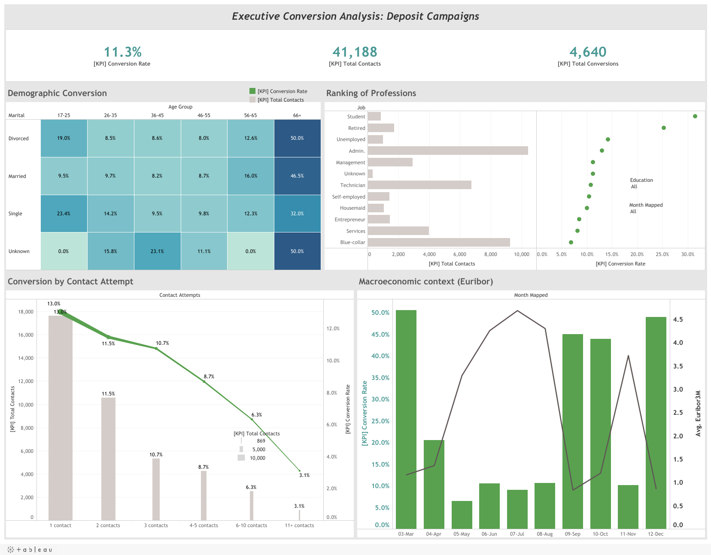

*Leer este documento en otros idiomas: [English](README.md)*

# Análisis de Campañas de Telemarketing Financiero y Optimización de Conversión

## Dashboard Interactivo

Explora el análisis interactivo en Tableau Public:
[Ver Dashboard en Tableau Public](https://public.tableau.com/app/profile/armando.guarnera/viz/BankMarketingDashboard_17825746467410/ExecutiveConversionAnalysisDepositCampaigns)

## Vista Previa del Dashboard



## Contexto de Negocio y Resumen Ejecutivo

Este proyecto analiza campañas de telemarketing directo de un banco minorista portugués entre mayo de 2008 y noviembre de 2010. El objetivo de negocio es entender qué factores sociodemográficos, operativos y macroeconómicos se asocian con que un cliente contrate un depósito a plazo.

Captar clientes en la banca minorista es cada vez más competitivo y costoso. El análisis ayuda a directores de marketing y gerentes de call center a decidir **a quién llamar y cuántas veces**, reduciendo el costo de las llamadas en frío y mejorando el retorno de las campañas.

---

## Arquitectura del Pipeline de Datos (`etl_pipeline.py`)

Un pipeline ETL reproducible en Python lleva los datos desde la ingesta hasta un dataset limpio y optimizado para Tableau.

### Etapas de Ingeniería de Datos

#### Ingesta Automatizada

- Descarga el dataset comprimido desde el UCI Machine Learning Repository.
- Lo extrae y gestiona la estructura local de archivos con `os`.

#### Ingeniería de Variables y Transformación

##### Variable Objetivo Binaria (`conversion_flag`)

Convierte la variable objetivo `y` ("yes"/"no") en un indicador 1/0, para calcular tasas de conversión directamente en la capa de BI.

##### Bandas de Edad (`age_group`)

Agrupa la edad en segmentos de negocio: `17-25`, `26-35`, `36-45`, `46-55`, `56-65` y `66+`.

##### Estandarización de Variables Categóricas

Etiqueta los valores faltantes como `Unknown` y aplica mayúsculas consistentes en variables categóricas como `job`, `marital` y `education`.

##### Orden Cronológico de Meses (`month_mapped`)

Convierte los códigos de mes en etiquetas ordenables (`03-Mar` ... `12-Dec`) para que Tableau respete el orden del calendario.

### Una Exclusión Deliberada: la Duración de la Llamada

La duración de la llamada está muy relacionada con la conversión, pero solo se conoce **después** de que la llamada termina: una llamada larga es consecuencia de un cliente interesado, no una palanca para elegir a quién llamar. Por eso el dashboard analiza los **intentos de contacto**, que el banco controla antes de marcar.

---

## Diseño del Dashboard en Tableau

El dashboard evita las plantillas por defecto y aplica principios de análisis visual.

### Reducción de la Carga Cognitiva

- Se eliminaron líneas de cuadrícula y bordes innecesarios.
- Los colores intensos se reservan para métricas accionables; el contexto va en grises neutros.

### Ejes Duales Sincronizados

En los gráficos que combinan métricas de distinta escala (volumen de contactos frente a tasa de conversión), las etiquetas de los ejes usan el color de sus marcas y se eliminan leyendas redundantes.

### Resumen Ejecutivo (BANs)

Tarjetas KPI grandes: tasa de conversión, total de contactos y total de conversiones.

### Tooltips Contextuales

Tooltips escritos en lenguaje de negocio en lugar de nombres de campos de la base de datos.

### Filtrado Global Interactivo

Seleccionar una profesión o una celda demográfica filtra todo el dashboard, para un análisis exploratorio rápido.

---

## Hallazgos Clave

### Línea Base

**41.188 contactos** generaron **4.640 contrataciones**: una **tasa de conversión de 11,3%**.

### La Edad Importa Más de lo Que Sugiere el Volumen

Los grupos más grandes son los que menos convierten. Los clientes de 36 a 55 años convierten entre 8,5% y 8,7%, mientras que los **mayores de 66 convierten al 46,8%** y los de 17 a 25 al 20,9%. Estudiantes (31,4%) y jubilados (25,2%) son las profesiones que mejor convierten, y los obreros (blue-collar) los que menos (6,9%), pese a ser el segundo grupo más grande.

### Cada Llamada Extra Rinde Menos

La conversión cae con cada contacto adicional dentro de la misma campaña: **13,0% en el primer contacto**, 11,5% en el segundo, 8,7% con 4-5 contactos y solo **3,1% con 11 o más**.

### El Éxito Pasado Predice el Éxito Futuro

Los clientes que contrataron en una campaña anterior convierten al **65,1%**, frente a 8,8% de los clientes nunca contactados antes. Los contactos por celular convierten al 14,7%, frente a 5,2% por teléfono fijo.

### El Contexto Macroeconómico

La conversión es mucho mayor cuando el Euribor a 3 meses está bajo: **45,7% por debajo de 1%**, frente a 4,8% por encima de 4%. Los meses con mayor conversión (marzo, septiembre, octubre y diciembre) son también los meses con menos llamadas. Como el entorno de tasas cambió en el tiempo (2008 frente a 2009-2010), esta relación mezcla condiciones de mercado con cambios en la forma de ejecutar las campañas.

---

## Recomendaciones Estratégicas

- **Limitar los intentos de contacto:** desde el tercer contacto la conversión ya está por debajo del promedio de la campaña, y a partir de cinco contactos es cercana a la mitad; conviene redirigir ese esfuerzo a nuevos prospectos.
- **Priorizar prospectos cálidos:** clientes que ya contrataron antes, y los segmentos de mayor y menor edad, antes que los grupos grandes de baja conversión.
- **Preferir el contacto por celular** cuando el número está disponible.
- **Ajustar la campaña al ciclo de tasas:** los depósitos a plazo se venden más fácil cuando las tasas de mercado están bajas.

---

## Limitaciones

El análisis es descriptivo y los datos son observacionales: que un segmento convierta mucho no prueba que llamarlo *cause* la contratación. El siguiente paso sería un modelo predictivo validado en el tiempo o una prueba controlada de campaña.

---

## Cómo Ejecutar Este Proyecto

```bash
git clone https://github.com/arguar13/Tableau-Bank-Marketing.git
cd Tableau-Bank-Marketing
pip install -r requirements.txt
python etl_pipeline.py
```

El script descarga y extrae el dataset y genera `end_bank_marketing_for_tableau.csv` (también incluido en el repositorio). Luego abre `Bank Marketing Dashboard.twbx` en Tableau Desktop o Tableau Public: el workbook empaquetado incluye su extracto de datos, así que abre directamente.

---

## Fuente de Datos

Moro, S., Cortez, P., & Rita, P. (2014). A data-driven approach to predict the success of bank telemarketing. *Decision Support Systems, 62*, 22-31. Dataset: *Bank Marketing* (bank-additional-full), UCI Machine Learning Repository.

---

## Autor

**Armando Guarnera**
Científico de Datos
Argentina
